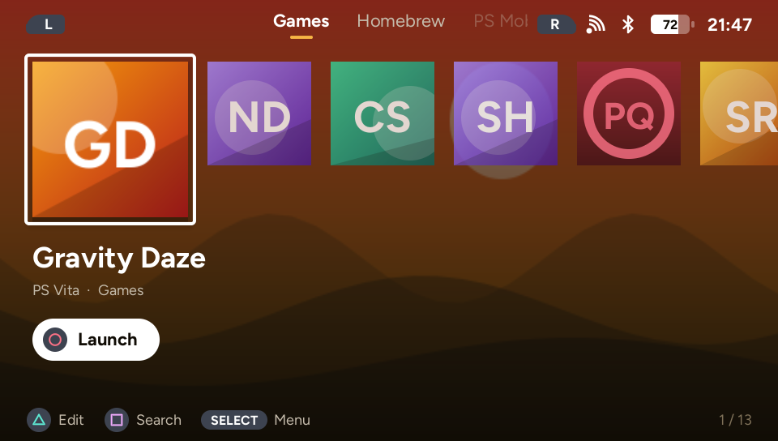
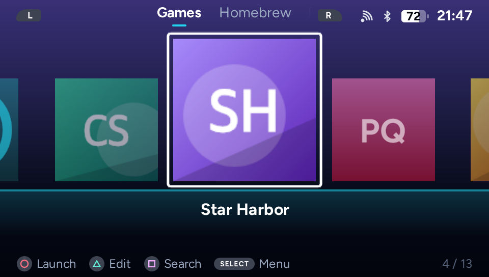
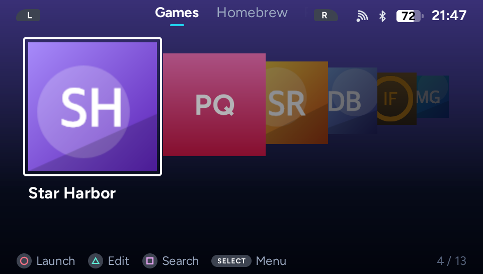
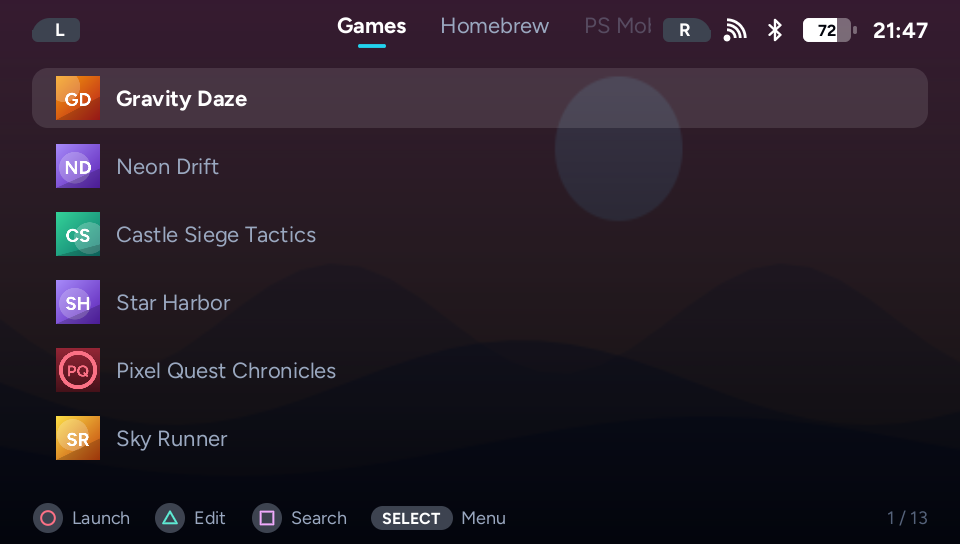
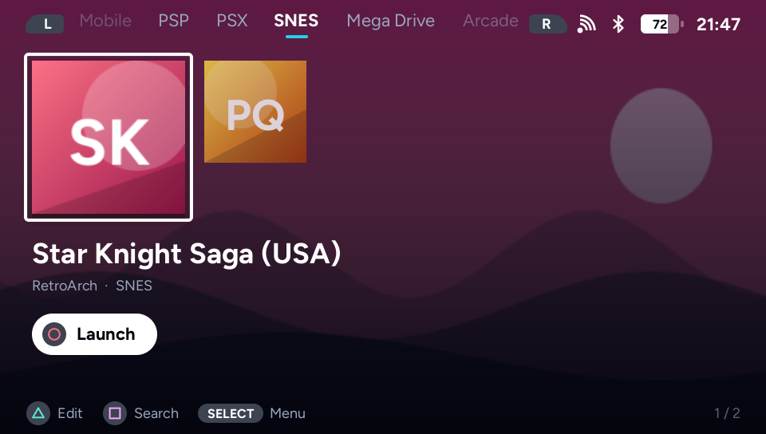

# Pocket Shelf

A launcher for the PS Vita. It lists the titles installed on the console
(Vita games, homebrew, PlayStation Mobile, PSP and PS1 games, and system
applications) and the games in your RetroArch playlists, in tabs. Each title
gets an icon and a backdrop, and it starts with one button press.

Pocket Shelf is a native Rust app: it draws with vita2d, rasterizes its own
text with `fontdue`, and runs the title scan, picture decoding, file writes and
downloads on worker threads. Up to 0.1 it was a TypeScript app on
[PocketJS](https://github.com/pocket-stack/pocketjs); 0.2 replaced it and kept
its saved data.

- Title id `POCKTSHLF`
- Version 0.2.0

<p align="center">
  
</p>

| Carousel | Cascade | Grid |
| --- | --- | --- |
|  |  |  |

| List | RetroArch | Menu |
| --- | --- | --- |
|  |  |  |

The screens are rendered on the desktop by `bun run shots` with sample titles;
the colored tiles with initials stand in for game icons.

## Features

- **Tabs per kind of title:** Games, Homebrew, PS Mobile, PSP, PSX, one tab
  per RetroArch console, and System last. You can add your own categories,
  and rename, reorder or hide any of them. "Last Played" and "Favorites" fill
  themselves.
- **Five views:** Home (the default), after the PS5 home screen: the selected
  title large at the left, its name and a Launch button below; a carousel; a
  five-column grid; a list; and a cascade after the Xbox 360 dashboard. Each
  has three detail levels: Basic, Normal and Detailed.
- **RetroArch games** from RetroArch's own playlists, one tab per console.
  Each game starts straight into the core its playlist names, without
  RetroArch's menu (see [RetroArch](#retroarch)).
- **PSP and PS1 games through Adrenaline.** This covers EBOOTs in
  `PSP/GAME` and ISO and CSO images in `ISO`. Pocket Shelf boots the game with
  its own small VSH plugin, so you don't have to pick it in the XMB. Before it
  installs or turns on the plugin, Pocket Shelf asks you.
- **Artwork from [SteamGridDB](https://www.steamgriddb.com/) or libretro's
  thumbnail server.** You can pick an icon and a backdrop for one title, or
  fetch artwork for a whole category at once. Choose the source: Auto
  (libretro for RetroArch games, SteamGridDB for the rest), SteamGridDB, or
  libretro (RetroArch, PS1 and PSP games, no key). SteamGridDB needs your own
  API key.
- **Long lists:** holding a direction speeds up, from one title at a time to
  twenty, so a tab of thousands of games can be crossed in seconds.
- **Search** across every tab with the on-screen keyboard.
- **Per-title changes:** name, category, icon, backdrop and favorite.
- **Six themes:** Midnight, Aurora, Sakura, Ember, Daylight, and Dynamic, which
  takes its colors from the selected title.
- **Status bar** with the clock, Wi-Fi, Bluetooth and battery, each of which
  can be hidden, on the left or the right of the top bar.
- **Five languages:** English, Turkish, German, French and Spanish.
- **Updates from GitHub** on the channel you pick (see [Updates](#updates)).

## Install

1. Download `pocket-shelf.vpk` from the newest tagged release, or build it
   yourself (see [Building](#building)).

   [](https://github.com/fthdgn-gh/pocket-shelf/releases)

   There is no stable release yet. The current one is the beta
   [`shelf-v0.2.0-beta.1`](https://github.com/fthdgn-gh/pocket-shelf/releases/tag/shelf-v0.2.0-beta.1)
   ([download the VPK](https://github.com/fthdgn-gh/pocket-shelf/releases/download/shelf-v0.2.0-beta.1/pocket-shelf.vpk)).
   GitHub marks betas as pre-releases, so its "Latest" label does not point to
   them. Releases come in three channels:
   - **Stable:** tested on hardware.
   - **Beta** (marked pre-release): new features, tested less.
   - **Nightly** (`shelf-nightly`, when available): the current `main`, untested.
2. Copy it to the Vita and install it with VitaShell.
3. Open Pocket Shelf from the home screen. On the first start it scans the
   installed titles and shows its progress. Later starts read the saved list.

After you install or remove a title, run **SELECT ▸ Library ▸ Rescan titles**.

### Updates

**SELECT ▸ Updates** sets the channel (Stable, Beta, Nightly or Off) and checks
for a newer release. Pocket Shelf also checks once a day at start. To install,
it downloads the VPK, then starts a separate app, Pocket Shelf Updater, which
installs it, opens the new version and is removed again.

### Adrenaline (PSP and PS1 games)

Both TheOfficialFloW's Adrenaline and isage's fork (8.x) are supported, but
only TheOfficialFloW's has been tested on hardware. The first time you start a
PSP or PS1 game, Pocket Shelf offers to add its plugin to Adrenaline's plugin
list. Nothing changes until you confirm. Adrenaline's own files and settings
are never modified.

### RetroArch

Install RetroArch for the Vita (`RETROVITA`) and scan your games into
playlists in RetroArch (Import Content). Pocket Shelf reads those playlists,
compressed or not, from `ux0:/data/retroarch/playlists`, or the folder
`retroarch.cfg` names. Each game starts with the core its playlist entry names,
else the playlist's default core, else an installed core for its console.

- After you add games to a playlist, run **Rescan titles**.
- Games whose file path holds `&` are left out: RetroArch cuts its launch
  parameter there. Rename the file to bring the game in.
- RetroArch's PlayStation and PSP games join the PSX and PSP tabs.

### SteamGridDB API key

Create a key in your SteamGridDB profile's preferences. You can type it in the
app, or put it as one line in `ux0:/data/PocketShelf/steamgriddb.txt`.

## Controls

| Button | Action |
| --- | --- |
| D-pad | Move the selection |
| L / R | Previous / next tab |
| ○ or ✕ (your choice in the menu) | Launch / back |
| △ | Edit the selected title |
| □ | Search |
| SELECT | Menu: appearance, library, confirm button, language, diagnostics |

## Data

Everything Pocket Shelf saves is in `ux0:/data/PocketShelf/`:

| File | Holds |
| --- | --- |
| `settings.json` | Settings and the last selection |
| `status-bar.json` | Which status items show, and on which side |
| `categories.json` | Your categories and their order |
| `titles/<title id>.json` | Your changes to one title |
| `titles.cache.json` | Every title's changes in one file, read at start |
| `recent.json` | The last 15 titles started |
| `art/`, `backdrops/` | Downloaded and chosen pictures |
| `libretro/` | libretro's name lists, one per console, fetched once |
| `steamgriddb.txt` | Your SteamGridDB API key |
| `update.json`, `update/` | The last update check; a downloaded update |
| `titles.tsv` | The scanned title list. Delete it to force a new scan |

The log is `ux0:/data/PocketShelfNext/log.txt`.

## Building

You need [Bun](https://bun.sh/), [Rust via rustup](https://rustup.rs/),
[VitaSDK](https://vitasdk.org/) with libvita2d, and
[cargo-vita](https://github.com/vita-rust/cargo-vita) 0.2.2. The Vita crate
pins its nightly toolchain in [`vita/rust-toolchain.toml`](./vita/rust-toolchain.toml).

```sh
bun install
bun run test      # core and platform module tests, on the desktop
bun run shots     # render every screen to .pocket-build/validation/desktop/
bun run build     # VPK at dist/vita/pocket-shelf.vpk
```

| Folder | Holds |
| --- | --- |
| [`core/`](./core/) | Everything but the platform: the library and saved files, the shelf's screens and panels, text, shapes, themes, artwork lookups, updates, the `Host` trait |
| [`vita/`](./vita/) | The Vita host, the vita2d backend and the frame loop; `vita/package/` holds the VPK's other files |
| [`desktop/`](./desktop/) | A software renderer and a fake host with sample titles, for `bun run shots` |
| [`platform-tests/`](./platform-tests/) | The Vita modules with no system calls, built for the desktop so their tests run there |
| [`locales/`](./locales/) | The texts in five languages; `bun run locales` writes `core/src/locales.rs` |
| [`updater/`](./updater/), [`psp-boot/`](./psp-boot/) | The updater app and the Adrenaline plugin (C) |
| [`tools/`](./tools/) | The locale generator, the build identity, the LiveArea artwork |
| [`docs/`](./docs/) | [Architecture](./docs/ARCHITECTURE.md), working [notes](./docs/NOTES.md), the port's [plan](./docs/PLAN.md) |

The updater app (`bun run updater`, needs VitaSDK) and the Adrenaline plugin
(`bun run plugin`, needs pspdev) are committed in `vita/package/`, so a build
needs neither toolchain.

### Releases

Three GitHub Actions workflows build and publish the VPK:

| Workflow | Does |
| --- | --- |
| [`shelf-build.yml`](./.github/workflows/shelf-build.yml) | Tests and builds the release VPK. The other two call it; "Run workflow" builds without publishing |
| [`shelf-release.yml`](./.github/workflows/shelf-release.yml) | On a `shelf-v*` tag, publishes a beta or stable release |
| [`shelf-nightly.yml`](./.github/workflows/shelf-nightly.yml) | Replaces the `shelf-nightly` pre-release with a build of `main`, once a day when `main` changed |

The tag's version must be the `version` in `package.json`:

```sh
git tag shelf-v0.2.0-beta.2   # beta: published as a pre-release
git tag shelf-v0.2.0          # stable: published as the latest release
git push origin <tag>
```

The nightly schedule is off until the repository variable `SHELF_NIGHTLY` is
set to `true` (Settings ▸ Secrets and variables ▸ Actions ▸ Variables).

## Contributors

- [Fatih Doğan](https://github.com/fthdgn-gh): author and maintainer.
- [Claude](https://github.com/claude) ([Claude Code](https://claude.com/claude-code)),
  Anthropic's AI model: co-author of the code and documentation.

## Credits

- [PocketJS](https://github.com/pocket-stack/pocketjs) by Yifeng "Evan" Wang
  and Pocket Nexus: Pocket Shelf began as a PocketJS app, in a fork of its
  repository, and its Vita platform modules began in the PocketJS Vita host.
- [SteamGridDB](https://www.steamgriddb.com/) for the artwork lookups.
- RetroFlow and VitaShell,
  for showing how to launch system applications and PlayStation Mobile titles,
  and how to lay out the LiveArea.

## License

[MIT](./LICENSE). Font: Figtree (SIL OFL 1.1), see
[`fonts/NOTICE.md`](./fonts/NOTICE.md).

The updater app in [`updater/`](./updater/) (`POCKTUPDR`, which installs
Pocket Shelf's updates) is a separate program under the
[GPL-3.0](./updater/LICENSE): it uses VitaShell's package installer code.
The VPK carries its build in `updater/`.
